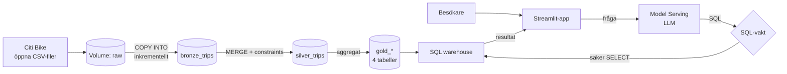
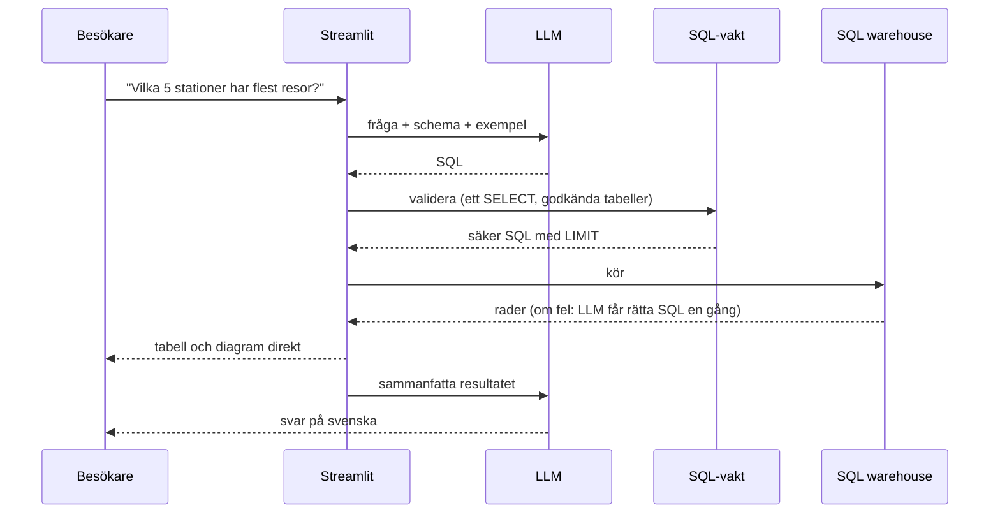

# Cykelstaden – Malvin Portfolio Project

[](https://github.com/DataMalle/cyclingproject/actions/workflows/ci.yml)

**Live demo:** https://cykelstaden-malvin.streamlit.app/

Ställ frågor på svenska om fem miljoner Citi Bike-resor i New York. En LLM översätter frågan till SQL, en
säkerhetskontroll validerar den, och Databricks kör den mot en kuraterad gold-modell som byggts av en ETL-pipeline.

## Arkitektur



### Vad som händer när någon ställer en fråga



## Designbeslut

**Pipeline**
- **Inkrementell och idempotent.** Bronze använder `COPY INTO`, som bara läser nya filer. Silver använder `MERGE` på
  `ride_id` och bearbetar bara rader som tillkommit sedan förra körningen. Omkörning ger samma resultat, och en ny
  månad kostar bara den månaden.
- **Datakvalitet i databasen.** Delta-constraints (`CHECK` på restid, användartyp och timme) gör att ogiltiga rader
  inte kan skrivas. Dessutom stoppar jobbet om för stor andel av en batch måste kasseras.
- **Dokumenterad modell.** Gold-tabellerna har tabell- och kolumnkommentarer som fungerar som dokumentation och som
  kontext till LLM:en.
- **Atomiska byten.** Gold byts med `CREATE OR REPLACE`, så appen läser aldrig en halvfärdig tabell, och behörigheter bevaras.

**Appen**
- **SQL-vakt (`app/sql_guard.py`).** Tillåter exakt ett `SELECT` mot fyra namngivna tabeller i projektets schema.
  Skrivande uttryck, farliga funktioner (`reflect`, `read_files`, `http_request` m.fl.) och tabeller i andra scheman avvisas.
  `LIMIT` läggs på utan att ändra sortering.
- **Minsta möjliga rättigheter.** Appen kör som en service principal med enbart `SELECT` på gold-tabellerna.
  Även om vakten skulle kringgås kan den inte läsa något annat eller skriva.
- **Självkorrigering.** Misslyckas SQL:en får LLM:en se felet och rätta den en gång innan appen ger upp.
- **Ratebegränsning** per session och per dygn skyddar kostnader och kvoter.

**Prestanda**
- **Tre cachelager:** SQL per fråga, resultat per SQL och sammanfattning. Samma fråga två gånger kostar inga nya LLM- eller warehouse-anrop.
- **Förvärmning.** Warehouse väcks i bakgrunden när sidan öppnas, så att första frågan inte väntar på kallstart.
- **Resultatet först.** Tabell och diagram visas direkt, och sammanfattningen fylls i när den är klar.
- **Tålig kallstart.** Appen väntar ut ett sovande warehouse och försöker om vid tillfälliga fel, istället för att avbryta.
- **Uppmätt:** en ny fråga tar 3–4 s från fråga till svar, en cachad fråga 0,2 s. En inkrementell omkörning av pipelinen
  tar 82 s och lämnar antalet rader oförändrat, mot cirka 170 s för en full ombyggnad (`full_refresh=true`).

**Tillförlitlighet**
- **Siffror räknas i Python, inte av LLM:en.** Små språkmodeller tappar siffror när de läser långa tal. Max, min och summa
  räknas därför i kod och skickas färdigformaterade, och modellen får bara återge dem. (Upptäckt när en sammanfattning
  skrev "över 630" för 66 497.)

## Struktur

| Sökväg | Innehåll |
|---|---|
| `databricks.yml`, `resources/` | Asset Bundle: schemalagt jobb och Databricks App |
| `src/pipeline/` | Notebooks: bronze (`COPY INTO`), silver (`MERGE`), gold |
| `app/app.py` | Streamlit-gränssnitt |
| `app/warehouse.py` | SQL mot warehouse med väntan och omförsök |
| `app/llm.py`, `app/schema_context.py` | LLM-anrop, prompts och exempel |
| `app/sql_guard.py` | Säkerhetskontroll av genererad SQL |
| `app/viz.py` | Automatiskt diagramval utifrån resultatets form |
| `app/ratelimit.py`, `app/config.py`, `app/style.py` | Ratebegränsning, konfiguration, tema |
| `tests/` | Enhetstester |

## Köra själv

```bash
databricks auth login --host https://<workspace>.cloud.databricks.com
databricks bundle deploy --var warehouse_id=<warehouse-id>
databricks bundle run cykelstaden_etl
```

Ladda upp Citi Bike-CSV-filer till volymen `raw/<YYYYMM>/` om ditt workspace blockerar utgående trafik till S3
(som Databricks Free Edition gör). Kör jobbet med `full_refresh=true` för att bygga om bronze och silver från början.
Appens secrets finns beskrivna i `app/.streamlit/secrets.toml.example`.

### Tester och kodkvalitet

```bash
pip install -r requirements-dev.txt
ruff check . && ruff format --check . && pytest
```

Totalt 45 tester täcker SQL-vakten, ratebegränsning, diagramval, konfiguration, warehouse-typning och LLM-lagret.
CI kör samma kontroller på varje push.

## Begränsningar

- Bara september 2024 är laddad. Fler månader läggs till genom att ladda upp filerna till volymen.
- LLM-genererad SQL kan bli fel eller för enkel. SQL:en visas under varje svar.
- Körs på Databricks Free Edition med kvoter. Första frågan efter en längre paus kan ta någon minut medan warehouse startar.

Datakälla: [Citi Bike System Data](https://citibikenyc.com/system-data).
